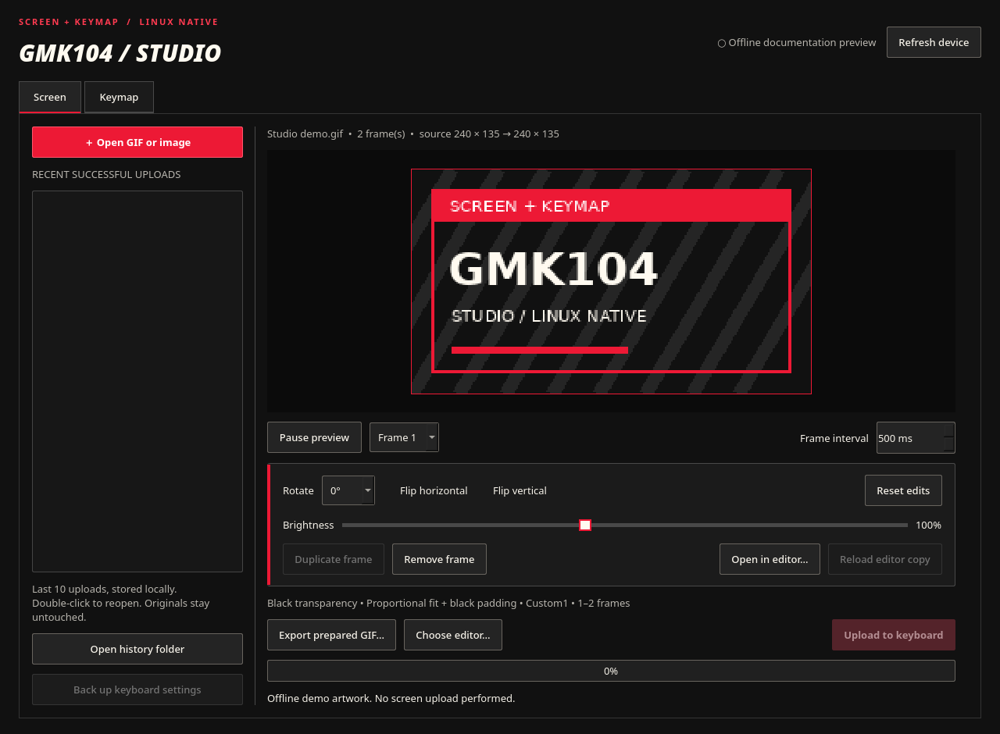
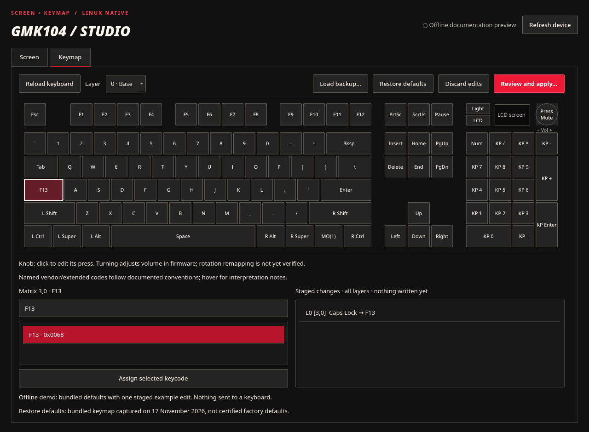

<p align="center">
  
</p>

<h1 align="center">GMK104 Studio</h1>
<p align="center"><strong>Screen editing and keymapping for the ZUOYA GMK104 on Linux.</strong></p>
<p align="center">
  <a href="https://github.com/Geoffery10/GMK104-Studio/actions/workflows/ci.yml"></a>
  <a href="https://github.com/Geoffery10/GMK104-Studio/releases/latest"></a>
  <a href="LICENSE"></a>
</p>

Make the screen yours. Make the keys yours. Upload artwork and edit four keyboard
layers in one native Qt app, on Wayland or X11. No Wine. No vendor driver.

> **Use at your own risk.** This is independent, reverse-engineered software,
> not an official manufacturer tool. Geoffery10 and contributors provide it
> without warranty and accept no liability for damaged devices or lost data,
> to the extent permitted by law. Read [device safety](SAFETY.md) before uploading
> artwork or applying keymap changes.

## Screenshots

### Screen



### Keymap



These are screenshots of the actual V2 UI in **offline demo mode**.
The artwork is original generated demo artwork. The keymap uses the bundled
captured defaults with one local example edit; no keyboard was accessed or changed.

## Features

### Screen editing

- Upload images or **one-/two-frame GIFs** to the keyboard's Custom1 screen.
- Open GIF, PNG, JPEG, WebP, and BMP artwork; render transparency on **black**.
- Fit artwork proportionally: **pillarboxing/letterboxing, never stretching**.
- Preview animation; rotate, flip, adjust brightness, duplicate/remove frames,
  and export prepared GIFs.
- Open an editable copy in your preferred external editor, then reload it.
- Keep the **last 10 successful uploads** locally. Long names elide with full
  hover text; the sidebar never needs horizontal scrolling.
- Read and back up live keyboard settings before each upload. Preserve unknown
  settings and the current clock/date; abort if reading or saving the backup fails.

### Keymapping

- **Automatic loading:** opening Keymap reads current mappings and saves a private
  backup. Reconnects are detected while the tab is open; staged edits are never
  silently discarded. **Reload keyboard** offers an explicit refresh.
- **Four layers:** switch between Base, Fn, layer 2, and layer 3 in a physical
  keyboard preview. The preview stays stable while editing/restoring and scales
  when the window is resized. Compact windows scroll rather than overlap controls.
- **Searchable key picker:** assign typing, navigation, modifier, function and
  numpad keys; disabled/transparent keys; momentary layer keys; mute/volume; and
  the identified backlight/LCD toggles.
- **Display-side controls:** the Light and LCD switches are labeled and editable.
  The round knob's **press** mapping is editable too; its captured default is Mute.
- **Fn-layer identification:** existing media, lighting, Bluetooth-slot,
  Windows-key lock, LCD-profile and other vendor codes have readable labels.
  Hover for matrix positions, exact hex values, and interpretation notes.
- **Unknown-code preservation:** unidentified values stay byte-for-byte intact
  unless explicitly replaced. Each layer reports unresolved keys; `0xFFFF`
  remains unresolved, not guessed to mean disabled, transparent, or reset.
- **Local staged edits:** click a key, search, and assign. Nothing is written until
  you confirm **Review and apply…**. Review a change list across all four layers,
  or discard local edits without touching the keyboard.
- **Guarded Apply:** re-read the keymap to detect external changes, save a full
  pre-write backup, write only changed two-byte mappings, and verify all layers.
  Screen and keymap operations cannot run together in the app.
- **Private automatic backups:** every successful read and every Apply saves a
  complete keymap snapshot. The first saved map is also retained separately as
  a permanent recovery baseline.
- **Restore defaults:** stage the bundled
  [captured keymap JSON](gmk104_app/assets/gmk104-default-keymap.json), independent
  of subsequent edits or local backup history. These are the project's saved
  defaults, **not manufacturer-certified factory defaults**.
- **Load backup:** validate and stage a GMK104 Studio keymap backup, review its
  differences, and explicitly Apply to restore. Restoration also backs up the
  current map first.
- **Stop on errors:** no automatic write retries or rollback. Failed operations
  require a fresh read before further editing.

**Current limits:** mouse bindings, macros, knob **rotation** remapping, arbitrary
raw-keycode entry, and a lighting-settings panel are not implemented. Rotation is
shown as native volume control, not a verified editable encoder map. Additional
Fn/vendor names are display-only interpretations; they are not automatically
offered as untested new assignments.

**Availability and validation:** v2.0 includes screen editing and keymapping in
both source builds and the AppImage. An unchanged-word write was verified against
a complete matching readback, and the keyboard owner reports successful changed
keymap writes on their device. Restoration and power-cycle persistence remain
unverified; testing does not cover every assignment or firmware revision.
See the [keymapping guide](docs/KEYMAPPING.md) for details.

## Compatibility

| Item | Support |
| --- | --- |
| Keyboard | ZUOYA GMK104, USB `320f:5055`; strict device/interface checks |
| Connection | Wired USB |
| Screen | Interface 3; 240 × 135, Custom1 |
| Animation | 1–2 frames, one global 500–1000 ms interval |
| Keymap | Interface 1; four layers, 8 × 15 matrix; observed protocol `0x00FF` |
| Linux desktop | Wayland or X11 |
| Download bundle | x86_64 AppImage; glibc-based Linux, Ubuntu 22.04 or newer baseline |
| Windows / macOS | Not supported; the device backend is Linux-specific |

Longer animations are rejected, not silently truncated. Different firmware
revisions remain untested. This is not a replacement for every function in the
manufacturer's software, and it does not flash firmware.

## Quick start: AppImage

The **v2.0 AppImage includes both Screen and Keymap**. Existing v1.0 installations
are screen-only; update to V2 for keymapping. Backups, history, and preferences
keep their existing locations.

1. Download the `.AppImage`, `70-gmk104.rules`, and `SHA256SUMS` from
   [Releases](https://github.com/Geoffery10/GMK104-Studio/releases/latest).
2. Check the AppImage against its entry in `SHA256SUMS`:

   ```bash
    sha256sum GMK104-Studio-2.0.0-x86_64.AppImage
   ```

3. Install the keyboard permission rule once:

   ```bash
   sudo install -m 644 70-gmk104.rules /etc/udev/rules.d/70-gmk104.rules
   sudo udevadm control --reload-rules
   ```

4. Unplug/reconnect the keyboard in **wired mode**. Close the Windows tool.
5. Run the AppImage as your regular user:

   ```bash
    chmod +x GMK104-Studio-2.0.0-x86_64.AppImage
    ./GMK104-Studio-2.0.0-x86_64.AppImage
   ```

**Never run the app as root.** The AppImage includes Python/Qt, but cannot
install system USB permissions for you. A local active desktop session is
required by the `uaccess` rule.

Open your image, check the preview and interval, then click **Upload to keyboard**.
That button starts immediately; there is no extra warning dialog.
Keep the keyboard connected until the upload finishes.

### Troubleshooting

- **Keyboard not found:** use wired mode, check `lsusb` for `320f:5055`, and close
  any other keyboard configuration app.
- **Needs permissions:** install the rule above and reconnect. Don't use broad
  `chmod` rules on all HID devices.
- **FUSE error:** try `./GMK104-Studio-2.0.0-x86_64.AppImage --appimage-extract-and-run`,
  or extract with `--appimage-extract` and run `squashfs-root/AppRun`.
- **Qt platform error:** try `QT_QPA_PLATFORM=wayland ./GMK104-Studio-2.0.0-x86_64.AppImage`
  or `QT_QPA_PLATFORM=xcb ...` on an X11 session.
- **Unsupported settings profile/descriptor:** stop and open an issue. Do not
  bypass the identity checks.

## Run from source

Python 3.11+ is required. Use a virtual environment; don't modify system Python.

```bash
git clone https://github.com/Geoffery10/GMK104-Studio.git
cd GMK104-Studio
python3 -m venv .venv
.venv/bin/python -m pip install -e .
.venv/bin/gmk104-studio
```

The same udev setup above is required. To install a source-checkout application
menu entry:

```bash
.venv/bin/python install-desktop.py
```

Keep the checkout and its virtual environment in place afterward.

### Remap keys

1. Connect the keyboard in **wired mode** and close VIA/other configuration tools.
2. Open **Keymap**; wait for the current mappings to load and back up.
3. Pick a layer and click a key. Search for a function, then click **Assign selected
   keycode** or double-click the search result.
4. Check the staged changes. **Discard edits** cancels local edits;
   **Restore defaults** or **Load backup…** stages a restoration instead.
5. Click **Review and apply…**, inspect Details, and explicitly confirm. Keep the
   keyboard connected until full verification finishes.

Keep a usable Fn/layer key. An interrupted Apply can leave a partial keymap;
backups are useful recovery data, not a guarantee of recovery. See
[keymapping safety and restoration](docs/KEYMAPPING.md).

## Test artwork

Only our generated test GIFs are included—no personal or game artwork:

| Single red | Single blue | Red / blue animation | Corner markers |
| :---: | :---: | :---: | :---: |
|  |  |  |  |

## Local files and backups

Usually under:

- `~/.local/share/GMK104/GMK104 Studio/uploads/`: last 10 successful GIFs.
- `~/.local/share/GMK104/GMK104 Studio/backups/`: private screen-settings and keymap
  backups; these are **not automatically pruned**.
- `~/.local/share/GMK104/GMK104 Studio/backups/baseline/keymap.json`: the permanent
  first-read keymap recovery snapshot, never replaced by later reads or edits.
- `~/.cache/GMK104/GMK104 Studio/`: editor working copies.
- `~/.config/GMK104/GMK104 Studio.conf`: editor/preferences.

XDG directory overrides are respected. **Open history folder** shows the actual
location. Screen backups contain settings and the read transcript; keymap
backups contain all four layers and an integrity checksum. Neither contains
firmware or the previous animation. Keymap restoration is explicit and reviewed;
there is no automatic retry or rollback.

The separate **Restore defaults** target ships with the app as
[`gmk104-default-keymap.json`](gmk104_app/assets/gmk104-default-keymap.json).
It is not replaced by live readings and is not a firmware factory-reset command.

## Command line

After installing from source:

```bash
# Read/back up settings only; no configuration or image writes.
.venv/bin/gmk104-upload --read-settings

# Explicit confirmation required before uploading.
.venv/bin/gmk104-upload tests/artwork/04-red-blue-500ms.gif --interval 500 --upload
```

## Development and releases

```bash
QT_QPA_PLATFORM=offscreen .venv/bin/python -m unittest discover -s tests -v
```

All tests are offline; they never upload to a keyboard. Public regression
fixtures are sanitized summaries/settings exchanges, not raw USB captures.

Regenerate the README screenshots without accessing a keyboard:

```bash
.venv/bin/python scripts/capture-screenshots.py
```

The helper uses the actual UI, generated demo artwork, the bundled keymap, and
temporary local app data. Device discovery is disabled and both HID transports
are guarded against access.

See [contributing](CONTRIBUTING.md), [protocol notes](docs/PROTOCOL.md), and
[AppImage build/release instructions](docs/BUILDING.md).
CI tests pull requests and pushes; version tags build and publish release
AppImages with SHA-256 checksums.

## License

[MIT](LICENSE) for our code and original icon, with no warranty.
Bundled dependencies retain [their own licenses](THIRD_PARTY_NOTICES.md).
The Persona 5-inspired palette includes no game assets. No vendor executable
or proprietary firmware is distributed.
